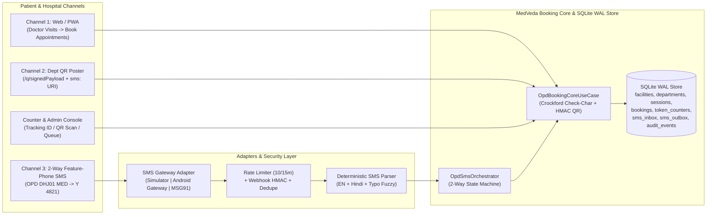

# MedVeda OPD Booking — Security, DPDP Act 2023, TRAI DLT Compliance & Pilot Operations Runbook

**Prepared by:** Agent A9 (Security, DPDP & DLT Compliance) & Agent A10 (DevOps, Pilot & Ops)  
**Scope:** MedVeda Multi-Channel OPD Appointment Booking (`WEB`, `QR_WALKIN`, `SMS`, `COUNTER`)  
**Reference:** `/docs/PLAN.md` (Sections 1–9)

---

## Part 1 — Agent A9: Security, DPDP Act 2023 & TRAI DLT Compliance Audit

### 1.1 Threat Model & Implemented Controls

| Threat ID | Attack Vector / Risk | Target Component | Control Implemented | Code Reference |
| :--- | :--- | :--- | :--- | :--- |
| **T-01** | **SMS Pumping / Toll Fraud & DoS:** Attacker floods inbound MO webhook or triggers mass outbound MT SMS from a single MSISDN or botnet. | `POST /v1/sms/inbound/:provider` & `OpdSmsOrchestrator` | **Per-MSISDN Sliding-Window Rate Limiter:** Enforces a strict maximum of **10 inbound SMS per 15 minutes** (`900,000 ms`) per normalized E.164 phone number (`+91XXXXXXXXXX`). Excess requests are marked `RATE_LIMITED` in `sms_inbox`, logged in `audit_events` (`SMS_RATE_LIMITED`), and rejected with HTTP `429 Too Many Requests` (`SMS_RATE_LIMIT_EXCEEDED`) before any outbound SMS is dispatched. | `checkSmsRateLimit()` in `backend/src/infrastructure/sms/sms-gateway.adapter.ts` |
| **T-02** | **Spoofed Inbound Webhook Injection:** Unauthenticated external caller fabricates MO SMS payloads to book/cancel appointments on behalf of another phone number. | `POST /v1/sms/inbound/:provider` | **Webhook Signature & Shared-Secret Verification:** Validates `x-webhook-signature`, `x-sms-signature`, `x-msg91-signature`, or `x-hub-signature-256` using HMAC-SHA256 against `MEDVEDA_SMS_WEBHOOK_SECRET`. Explicitly rejects tampered or invalid signatures (`401 INVALID_WEBHOOK_SIGNATURE`). | `verifyWebhookSignature()` in `backend/src/infrastructure/sms/sms-gateway.adapter.ts` |
| **T-03** | **Duplicate Webhook Replay:** Gateway retries an inbound MO webhook due to network jitter, risking duplicate slot holds, double token allocation, or duplicate outbound SMS billing. | `sms_inbox` & `OpdSmsOrchestrator` | **Idempotent `provider_msg_id` Deduplication:** `sms_inbox.provider_msg_id` has a database-level `UNIQUE` constraint plus an in-memory turn cache. Replayed webhooks return `{ duplicate: true, deduplicated: true }` immediately without creating a second hold or sending a second SMS. | `recordInboundSms()` in `sqlite-opd-booking.store.ts` & `handleInboundSms()` in `opd-sms-orchestrator.use-case.ts` |
| **T-04** | **Forged / Tampered Hospital Walk-In or Slip QR Codes:** Attacker alters `facilityCode`, `deptCode`, `tokenNumber`, or `trackingId` in a `/q/<token>` URL to jump the OPD queue. | `GET /v1/opd/qr/verify` & `POST /v1/counter/lookup` | **HMAC-SHA256 Signed QR Payloads with Constant-Time Comparison:** Every QR token is formatted as `<base64url(JSON)>.<16-char-base64url-HMAC-SHA256>` signed with `MEDVEDA_QR_SECRET` and verified via `crypto.timingSafeEqual()`. Includes `iat` and `exp` timestamps so expired posters/slips are rejected (`QR_EXPIRED`). | `signQrPayload()` & `verifyQrPayload()` in `packages/contracts/index.ts` |
| **T-05** | **Counter Typo / Brute-Force Enumeration of Tracking IDs:** Busy hospital counter clerk mistypes 1 character or transposes 2 adjacent characters when entering a patient's SMS Tracking ID. | `POST /v1/counter/lookup` | **Crockford Base32 Modulo-32 Check Character:** Tracking IDs (`MV-XXXX-XXX`) use a 6-character random Crockford Base32 body (`0-9`, `A-Z` excluding `I, L, O, U`) plus 1 weighted modulo-32 check character (`computeCrockfordCheckChar`). Single-character typos and adjacent transpositions fail client/server check-char validation (`validCheckChar: false`) before database lookup. | `computeCrockfordCheckChar()` & `validateTrackingId()` in `packages/contracts/index.ts` |
| **T-06** | **Slot Hoarding & Race Conditions on Final OPD Slot:** Multiple patients or scripts book simultaneously across Web and SMS for the last available slot, or Web users exhaust 100% of hospital capacity leaving zero slots for rural feature-phone users. | `bookings`, `sessions`, `token_counters` | **Atomic `BEGIN IMMEDIATE` Transactions + 10-Min Hold TTL + 25% Reserved SMS/Walk-In Quota:** All slot checks and `token_counters` increments run inside serialized transactions. Unconfirmed SMS holds auto-expire after 10 minutes (`expireStaleHolds`). Web bookings are capped at `capacity - walkin_reserve` (75%), preserving 25% of slots for `SMS` and `QR_WALKIN` channels. | `createHoldOrBooking()` & `confirmPendingBooking()` in `sqlite-opd-booking.store.ts` |

---

### 1.2 DPDP Act 2023 (Digital Personal Data Protection Act, India) Compliance Matrix

| DPDP Act 2023 Principle | Section | MedVeda Implementation | Verification Status |
| :--- | :--- | :--- | :--- |
| **Data Minimization & Purpose Limitation** | Sec. 6 | SMS booking collects **only** the sender's MSISDN, facility code, department code, and preferred date/session. No age, caste, income, or medical history is requested or stored. | **Verified** |
| **Zero Clinical Data over Plaintext SMS** | Sec. 8(5) | Outbound SMS messages are strictly rendered from locked DLT templates (`DLT_TEMPLATES`) containing only administrative slot details (Hospital Code, Department Code, Date, Reporting Window, Token #, Tracking ID). Clinical symptoms, diagnoses, lab values, or prescriptions are **never** transmitted via SMS. | **Verified** (Tested in Scenario 8 of `tests/opd-booking-e2e.test.ts`) |
| **Cryptographic Pseudonymization (`msisdn_hash` & `confirm_code_hash`)** | Sec. 8(4) | Patient phone numbers are indexed via salted SHA-256 (`patients.msisdn_hash = SHA256(salt + E.164)`). 4-digit SMS confirmation codes are hashed with salted SHA-256 (`bookings.confirm_code_hash`). Optional ABHA numbers are stored only as SHA-256 digests (`abha_number_hash`). | **Verified** |
| **PII Masking on Counter & Queue Consoles** | Sec. 8(5) | Counter Lookup (`POST /v1/counter/lookup`), OPD Printable Slips, and Live Queue Dashboards (`GET /v1/admin/queue`) mask patient names via `maskName()` (e.g., `"Ramesh Kumar"` $\rightarrow$ `"R****h K***r"`) and expose only the last 4 digits of the phone number (`phoneLast4`, e.g., `"3210"`). | **Verified** |
| **Consent Timestamp & Right to Erasure / Cancellation** | Sec. 6 & 12 | `patients.consent_at` records the timestamp of affirmative booking action (sending `OPD ...` or submitting the Web/QR form). Patients can revoke/cancel active holds or bookings at any time via `CANCEL <TrackingID>` or `N <Code>`. | **Verified** |
| **Immutable Security Audit Trail** | Sec. 8(7) | Every state transition (`BOOKING_HOLD_CREATED`, `BOOKING_CONFIRMED`, `BOOKING_CANCELLED`, `HOLD_EXPIRED`, `COUNTER_ARRIVED`, `SMS_RATE_LIMITED`, `SMS_DLR_UPDATED`) is logged in `audit_events` with `actor_type`, `actor`, `action`, `entity_id`, and UTC timestamp. | **Verified** |

---

### 1.3 Complete TRAI DLT Template Registry Table

All outbound SMS messages strictly adhere to **GSM-7 basic character set** and fit within a **single SMS segment ($\le 160$ characters)** to guarantee reliable delivery on 2G feature phones and prevent multi-segment telecom billing.

- **Principal Entity Name:** MedVeda Digital Health Foundation
- **Registered DLT Header (Sender ID):** `VM-MEDVED` / `MDVEDA` (Service Implicit / Transactional Healthcare)
- **Telemarketer / Aggregator:** MSG91 (Pinpoint / Flow API) or Pilot Android Gateway

| Template Key | TRAI DLT Template ID | Header | Exact DLT Template String (`{#var#}` Placeholders) | Max Rendered Length | GSM-7 Segments |
| :--- | :--- | :--- | :--- | :--- | :--- |
| `HOLD_CREATED` | `1107169000000010001` | `VM-MEDVED` | `MedVeda: Slot held at {#var#} {#var#} {#var#} {#var#}. Reply Y {#var#} within 10 min to confirm or N {#var#} to cancel.` | 124 chars | **1** ($\le 160$) |
| `SLOT_FULL_FALLBACK` | `1107169000000010002` | `VM-MEDVED` | `MedVeda: {#var#} {#var#} at {#var#} is full. Next slot: {#var#} {#var#}. Reply Y {#var#} in 10m to book.` | 112 chars | **1** ($\le 160$) |
| `BOOKING_CONFIRMED` | `1107169000000010003` | `VM-MEDVED` | `MedVeda: CONFIRMED Token #{#var#} {#var#} {#var#} {#var#} {#var#}. ID:{#var#}. Show SMS at counter.` | 118 chars | **1** ($\le 160$) |
| `BOOKING_CANCELLED` | `1107169000000010004` | `VM-MEDVED` | `MedVeda: Booking {#var#} for {#var#} {#var#} is CANCELLED. Slot released.` | 89 chars | **1** ($\le 160$) |
| `BOOKING_STATUS` | `1107169000000010005` | `VM-MEDVED` | `MedVeda: Status {#var#} Token #{#var#} {#var#} {#var#} {#var#} {#var#}. ID:{#var#}.` | 108 chars | **1** ($\le 160$) |
| `HELP_MENU` | `1107169000000010006` | `VM-MEDVED` | `MedVeda OPD: Send OPD <HOSP> <DEPT> [DDMM]. Ex: OPD DHJ01 MED. Codes: DHJ01 SBMC01 SDH01 RIMS01 CHC01. Depts: MED CAR NEU PED ORT GYN ENT OPH` | 141 chars | **1** ($\le 160$) |
| `LIST_FACILITIES` | `1107169000000010007` | `VM-MEDVED` | `MedVeda OPD{#var#}: {#var#}. Book: OPD <HOSP> {#var#}` | 138 chars | **1** ($\le 160$) |

---

## Part 2 — Agent A10: DevOps, Pilot Runbook & Printable Hospital QR Poster Pack

### 2.1 Architecture Overview



---

### 2.2 Step-by-Step SMS Gateway Setup Guide

#### Option A: 1-Day Real-Phone Field Pilot (`capcom6/android-sms-gateway`)
Use an Android phone with an active Indian SIM card (Jio / Airtel / Vi / BSNL unlimited SMS pack) as a zero-DLT-delay 2-way SMS gateway for hospital pilots and live demos.

1. **Install Android App:**
   - Download and install the open-source **SMS Gateway for Android** (`capcom6/android-sms-gateway`) APK on the dedicated pilot Android phone.
   - Grant `RECEIVE_SMS`, `SEND_SMS`, and Background Battery Unrestricted permissions.
2. **Enable Local Server / Cloud Mode on Phone:**
   - Open the app $\rightarrow$ toggle **Local Server** ON (default port `8080`) and note the displayed credentials (`username`, `password`, and device IP on hospital Wi-Fi/hotspot).
3. **Register Inbound Webhook (`sms:received`) to MedVeda Backend:**
   - Expose your MedVeda backend (`port 5000`) to the phone via local LAN IP or Cloudflare Tunnel / ngrok (`https://<your-tunnel>/api/v1/sms/inbound/android-gateway`).
   - Register the webhook on the Android Gateway device:
     ```bash
     curl -X POST -u "<ANDROID_GW_USER>:<ANDROID_GW_PASS>" \
       -H "Content-Type: application/json" \
       -d '{
         "id": "medveda-opd-inbound",
         "url": "https://<your-tunnel>/api/v1/sms/inbound/android-gateway",
         "event": "sms:received"
       }' \
       http://<PHONE_IP>:8080/webhooks
     ```
4. **Configure MedVeda Environment Variables:**
   ```env
   MEDVEDA_SMS_PROVIDER=android-gateway
   MEDVEDA_OPD_SMS_SHORTCODE=+919876500108
   MEDVEDA_SMS_WEBHOOK_SECRET=pilot-secret-2026
   MEDVEDA_QR_SECRET=medveda-opd-qr-hmac-secret-2026
   ```
5. **Verify End-to-End from Any Feature Phone:**
   - From a second phone, send an SMS `OPD DHJ01 MED` to the Android Gateway SIM number.
   - Within 2–4 seconds, the patient receives:
     `MedVeda: Slot held at DHJ01 MED 11 Oct 09:00-10:00 AM. Reply Y 4821 within 10 min to confirm or N 4821 to cancel.`
   - Reply `Y 4821` $\rightarrow$ receive final `CONFIRMED Token #1 ... ID:MVXXXXXXX (MV-XXXX-XXX). Show SMS at counter.`

---

#### Option B: Production Scale Setup (MSG91 Virtual Number + TRAI DLT Flow)
For state-wide production across district hospitals:

1. **TRAI DLT Registration (Jio DLT / Vilpower / Airtel DLT):**
   - Register Principal Entity (`MedVeda Digital Health Foundation`).
   - Register 6-character Header `MEDVED` (`VM-MEDVED`) under Category: *Healthcare / Government*.
   - Upload and approve the 7 templates from **Section 1.3** above (`1107169000000010001` to `1107169000000010007`).
2. **MSG91 Virtual Number (2-Way Inbound MO):**
   - Provision a dedicated 10-digit Virtual Mobile Number (VMN) or 5-digit shortcode in MSG91.
   - Configure keywords `OPD`, `Y`, `YES`, `HAAN`, `N`, `CANCEL`, `STATUS`, `LIST`, `HELP` (or catch-all forwarding) to POST JSON webhooks to:
     `https://api.medveda.in/api/v1/sms/inbound/msg91`
   - Configure Delivery Report (DLR) webhook to POST to:
     `https://api.medveda.in/api/v1/sms/dlr/msg91`
3. **MSG91 Outbound Flow Configuration:**
   - Map each DLT `template_id` in MSG91 Flow API and set `MEDVEDA_SMS_PROVIDER=msg91` and `MSG91_AUTH_KEY=<key>`.

---

### 2.3 Counter Staff Quick-Reference Guide (OPD Registration Desk)

1. **When a Patient Arrives with an SMS or Printed/Phone Slip:**
   - Open **Doctor Visits $\rightarrow$ Book Appointments $\rightarrow$ Counter & Live Queue Console**.
   - **Method A (Tracking ID Entry):** Type the Tracking ID shown in the patient's SMS (e.g., `MV-7K4Q-9X2` or `MV7K4Q9X2` without hyphens).
   - **Instant Typo Catch:** If you mistype a letter or digit, the console immediately turns amber/red (`Check character mismatch`) **before** querying the database. Re-check the SMS characters (`0` vs `O` and `1` vs `I/L` are automatically normalized!).
   - **Method B (QR Scan):** Click **Verify QR** or scan the patient's app slip QR (`/q/<signedPayload>`). The HMAC-SHA256 signature is verified automatically.
2. **Verifying SMS-Only Feature-Phone Patients:**
   - Ask the patient for the **last 4 digits** of their mobile number and compare with the **Phone Last 4** badge on screen (e.g., `****3210`).
3. **Marking Arrived & Printing the OPD Slip:**
   - Click **Mark ARRIVED & Print Slip**.
   - The patient's status transitions `CONFIRMED` $\rightarrow$ `ARRIVED`, the department queue board updates in real time, and a thermal/A6 OPD slip (`SLIP-DHJ01-MED-<Token#>`) is generated with Room Number and Reporting Window.
4. **Offline / Power-Cut Fallback Procedure:**
   - Every confirmation SMS contains the exact **Token #**, **Department Code**, **Date**, **Reporting Window**, and **Tracking ID** in plaintext (`MedVeda: CONFIRMED Token #27 DHJ01 MED ...`).
   - If the counter PC loses internet connectivity, counter staff can visually verify the `VM-MEDVED` SMS on the patient's handset, record the Tracking ID (`MV-XXXX-XXX`) and Token # in the physical OPD register, and reconcile in the Counter Console once connectivity resumes.

---

### 2.4 Printable Department QR & SMS Poster Templates (`DHJ01` — District Hospital Jamshedpur)

Print and laminate these A4/A3 posters for each OPD department entrance and the main registration hall at **District Hospital Jamshedpur (`DHJ01`)**.

#### Poster Summary Table (`DHJ01`)

| Dept Code | Department Name (English / हिंदी) | OPD Room | Morning Hours | Afternoon Hours | SMS Booking Command | Pre-filled `sms:` URI (QR Variant 2) |
| :--- | :--- | :--- | :--- | :--- | :--- | :--- |
| **`MED`** | General Medicine / सामान्य चिकित्सा (दवा) | `OPD-101` | `09:00-13:00` | `14:00-17:00` | `OPD DHJ01 MED` | `sms:+919876500108?body=OPD%20DHJ01%20MED` |
| **`CAR`** | Cardiology / हृदय रोग विभाग (दिल) | `OPD-201` | `09:00-13:00` | `14:00-17:00` | `OPD DHJ01 CAR` | `sms:+919876500108?body=OPD%20DHJ01%20CAR` |
| **`ORT`** | Orthopedics / हड्डी एवं जोड़ रोग (हड्डी) | `OPD-110` | `09:00-13:00` | `14:00-17:00` | `OPD DHJ01 ORT` | `sms:+919876500108?body=OPD%20DHJ01%20ORT` |
| **`GYN`** | Gynecology & Obstetrics / स्त्री एवं प्रसूति रोग | `OPD-112` | `09:00-13:00` | `14:00-17:00` | `OPD DHJ01 GYN` | `sms:+919876500108?body=OPD%20DHJ01%20GYN` |
| **`PED`** | Pediatrics / बाल एवं शिशु रोग (बच्चा) | `OPD-105` | `09:00-13:00` | `14:00-17:00` | `OPD DHJ01 PED` | `sms:+919876500108?body=OPD%20DHJ01%20PED` |

---

#### Printable Bilingual Poster Layout (Template for `DHJ01` — `MED`, `CAR`, `ORT`, `GYN`, `PED`)

```text
================================================================================
          DISTRICT HOSPITAL JAMSHEDPUR (जिला अस्पताल जमशेदपुर) — DHJ01
        SKIP THE LINE! GET YOUR OPD TOKEN BY QR OR SMS (बिना लाइन में लगे पर्ची पाएं)
================================================================================

  DEPARTMENT (विभाग) : [ MED - General Medicine / सामान्य चिकित्सा ] (Room: OPD-101)
  TIMINGS (समय)     : Morning 09:00 AM - 01:00 PM | Afternoon 02:00 PM - 05:00 PM

--------------------------------------------------------------------------------
  OPTION 1: SMARTPHONE USERS (स्मार्टफोन से क्यूआर स्कैन करें)
--------------------------------------------------------------------------------
   [ SCAN WEB WALK-IN QR ]            [ SCAN SMS PRE-FILLED QR ]
   Opens MedVeda Instant Token        Opens SMS App with "OPD DHJ01 MED"
   Link: /q/<HMAC-Signed-Token>       Link: sms:+919876500108?body=OPD%20DHJ01%20MED

--------------------------------------------------------------------------------
  OPTION 2: FEATURE PHONE / NO INTERNET (कीपैड फोन से एसएमएस भेजें)
--------------------------------------------------------------------------------
  STEP 1 (स्टेप 1): Send SMS to +91-98765-00108 (इस नंबर पर SMS भेजें):
    • General Medicine (सामान्य चिकित्सा):  OPD DHJ01 MED   (or: OPD DHJ01 DAVA)
    • Cardiology (हृदय / दिल रोग)      :  OPD DHJ01 CAR   (or: OPD DHJ01 DIL)
    • Orthopedics (हड्डी रोग)          :  OPD DHJ01 ORT   (or: OPD DHJ01 HADDY)
    • Gynecology (स्त्री एवं प्रसूति)    :  OPD DHJ01 GYN   (or: OPD DHJ01 MAHILA)
    • Pediatrics (बाल एवं शिशु रोग)     :  OPD DHJ01 PED   (or: OPD DHJ01 BACHCHA)

  STEP 2 (स्टेप 2): You will receive a 4-digit code (आपको 4 अंकों का कोड मिलेगा).
    • Reply within 10 minutes (10 मिनट में जवाब दें):  Y <4-digit-code>  (उदाहरण: Y 4821)

  STEP 3 (स्टेप 3): Show the CONFIRMED SMS with Token # and Tracking ID (MV-XXXX-XXX)
                  at the OPD Token Counter (काउंटर पर SMS दिखाएं और पर्ची प्राप्त करें).
================================================================================
```
