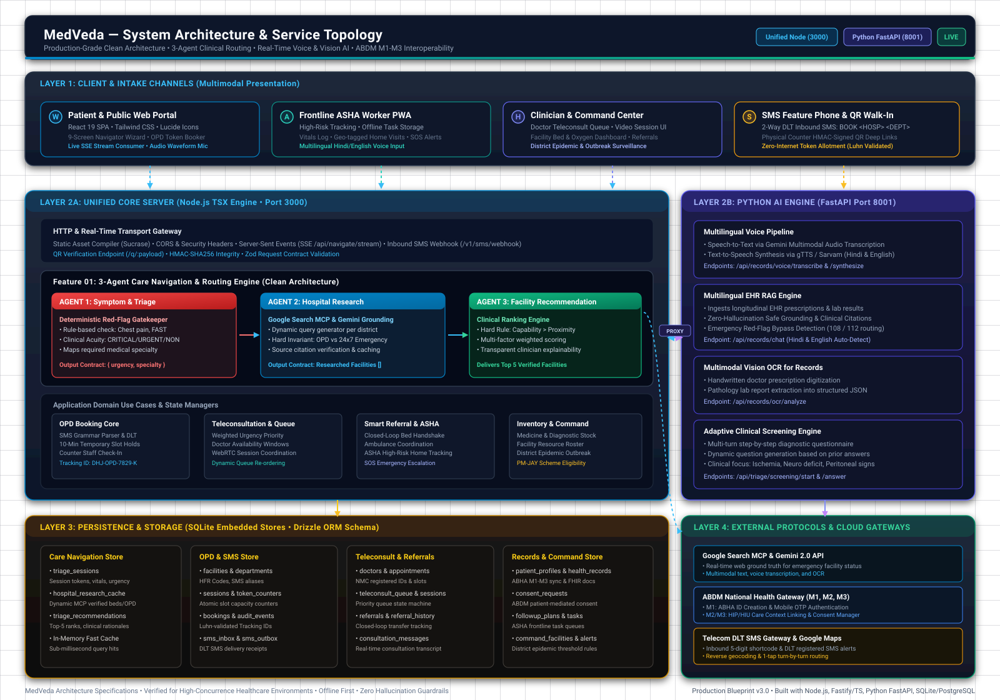
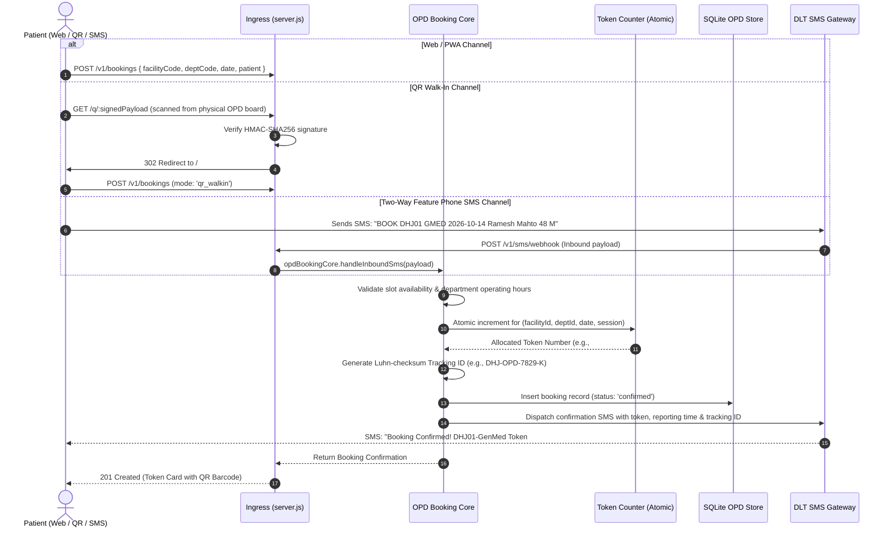
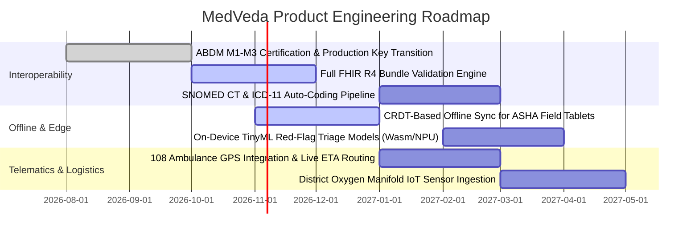

# MedVeda — Comprehensive Technical Design Document

**Document Version:** 3.2.0  
**Status:** Approved for Implementation & Production Verification  
**System Classification:** Life-Critical Clinical Care Navigation & Healthcare Logistics Platform  
**Target Operating Environment:** Primary, Secondary & Tertiary Health Centers, Frontline Community Health (ASHA), and Public Mobile/Web Access  

---

## 1. System Overview and Requirements

### 1.1 Executive Summary
**MedVeda (Smart Care Navigator)** is an intelligent, clinical-safety-first healthcare routing and facility logistics platform engineered for patients, healthcare workers (ASHA/ANM), and clinicians across underserved, rural, and tier-2/3 regions.

In rural and peri-urban India, acute clinical presentations frequently result in morbidity or mortality due to **navigational failure**:
1. **Urgency Misclassification:** Patients fail to recognize acute red-flag presentations (e.g., atypical myocardial infarction, stroke within the thrombolytic window, acute abdomen, or neonatal distress).
2. **Specialty Mismatch:** Patients travel hours to nearby community health centers only to discover that specialized care (e.g., acute cardiology or emergency neurology) is either non-existent or restricted strictly to outpatient hours (OPD-only).
3. **Capacity Opacity:** Nearest emergency facilities often lack functional oxygen manifolds, active blood banks, or vacant ICU beds, causing fatal transfer delays.
4. **Digital Divide:** High-bandwidth, app-only solutions fail in rural districts where network connectivity fluctuates between 2G, intermittent 4G, and total blackouts.

MedVeda resolves this crisis by marrying a **Deterministic + AI 3-Agent Clinical Pipeline** with **Google Search MCP real-time hospital research**, an **omnichannel low-bandwidth booking engine (Web, HMAC QR Deep Links, and Two-Way DLT SMS)**, and an **EHR-integrated Multilingual Voice & Multimodal Vision microservice**.

```
┌─────────────────────────────────────────────────────────────────────────────────┐
│                           MEDVEDA CORE MOTTO & INVARIANT                         │
│                                                                                 │
│         "Clinical Capability > Proximity: Never route an acute patient to       │
│          a closer clinic that lacks verified emergency intervention."           │
└─────────────────────────────────────────────────────────────────────────────────┘
```

---

### 1.2 System Requirements

#### Functional Requirements (FR)
- **FR-01: Multimodal Symptom Triage & Red-Flag Interception:** Accept symptom descriptions via voice (Hindi/English), text, or structured checklists. Detect acute red-flag signs (FAST stroke criteria, radiating chest pain, stridor, peritoneal rigidity) within $<200\text{ ms}$ using deterministic rule gates before AI inference.
- **FR-02: Live Grounded Hospital Discovery:** Research facilities dynamically using the **Google Search MCP Adapter** and **Gemini Search Grounding**, verifying active 24x7 emergency coverage vs. OPD-only clinics with verifiable citations.
- **FR-03: Clinically-Weighted Recommendation Engine:** Rank facilities using a multi-factor clinical scoring algorithm that penalizes facilities lacking verified emergency intervention for critical cases, regardless of physical proximity.
- **FR-04: Omnichannel OPD Appointment & Token Allotment:** Support appointment scheduling through responsive Web/PWA, offline-capable physical QR walk-in posters (`/q/:signedPayload`), and 2-way DLT SMS grammar (`BOOK <HOSP_CODE> <DEPT_CODE>`) on basic feature phones.
- **FR-05: Dynamic Teleconsultation & Triage Queue:** Provide real-time queue management for remote medical officers, dynamically prioritizing patients by clinical acuity tier.
- **FR-06: Closed-Loop Referral & Transfer Coordination:** Maintain an immutable state machine for inter-facility patient transfers, ensuring bed reservation and transfer acknowledgments before patient dispatch.
- **FR-07: Frontline ASHA High-Risk Patient Tracking:** Enable community health workers to log longitudinal antenatal and chronic care follow-ups with offline task caching and SOS emergency triggers.
- **FR-08: Multilingual EHR RAG & Prescription OCR:** Digitize handwritten prescriptions and diagnostic reports via Gemini Multimodal Vision, and provide RAG queries grounded strictly in patient longitudinal records with zero hallucination.
- **FR-09: District Command Center & Syndromic Surveillance:** Aggregate anonymized triage signals and facility resource levels to detect localized epidemic outbreaks (e.g., Dengue, Malaria, Encephalitis).

#### Non-Functional Requirements (NFR)
- **NFR-01: Latency & Streaming Performance:** Complete full 3-agent care navigation in $<2.5\text{ seconds}$ end-to-end. Provide streaming progress updates to the client via Server-Sent Events (SSE) with first token delivered in $<350\text{ ms}$.
- **NFR-02: Availability & Fault Tolerance:** Maintain $99.95\%$ uptime. The system must operate in a degraded offline/cached mode if external AI or Google Search APIs experience transient failures.
- **NFR-03: Security & Privacy (DPDP & ABDM Compliance):** Comply with India's Digital Personal Data Protection (DPDP) Act 2023 and Ayushman Bharat Digital Mission (ABDM) guidelines. Never persist unmasked Aadhaar or raw biometric credentials; sanitize patient PII before sending prompts to external LLMs.
- **NFR-04: Zero-Dependency Portability:** Execute the full production stack via a unified Node.js supervisor (`frontend/server.js`) that auto-spawns and monitors the Python AI microservice, utilizing SQLite embedded stores for lightweight edge/district hospital appliances.
- **NFR-05: Low-Bandwidth Optimization:** Ensure core client bundle size is $<180\text{ KB}$ gzipped. The SMS channel must operate with zero internet dependency over standard cellular control channels.

---

## 2. Architecture Diagram

The system employs a **Hexagonal (Ports and Adapters) Clean Architecture** paired with a microservice orchestration topology.



### 2.1 Component Interconnection (Mermaid Flow)

```mermaid
flowchart TB
    subgraph Clients["Layer 1: Multimodal Client & Ingress Channels"]
        WEB["Patient Web & PWA Portal<br/>(React 19 / Tailwind / SSE / Mic)"]
        ASHA["Frontline ASHA Worker App<br/>(Offline PWA / Geotagged Tasks)"]
        DOC["Doctor & Command Portal<br/>(Teleconsult Queue / Bed Roster)"]
        SMS_CL["Feature Phone SMS / QR<br/>(2-Way DLT / Luhn Token)"]
    end

    subgraph NodeServer["Layer 2A: Unified Core Server (Node.js Port 3000)"]
        INGRESS["HTTP / SSE Ingress Gateway<br/>(Sucrase Compiler, Static Server, Security Headers)"]
        QR_VERIF["QR Walk-In Deep Link Parser<br/>(/q/:signedPayload — HMAC SHA-256)"]
        SMS_WEBHOOK["SMS Inbound Gateway Webhook<br/>(/v1/sms/webhook)"]
        
        subgraph Pipeline["3-Agent Care Navigation Engine"]
            AG1["Agent 1: Symptom & Triage<br/>(Red-Flag Gatekeeper + Urgency Classifier)"]
            AG2["Agent 2: Hospital Research<br/>(Google Search MCP + Gemini Grounding)"]
            AG3["Agent 3: Clinical Ranking<br/>(Capability > Proximity Scoring)"]
        end

        subgraph CoreUseCases["Domain Application Use Cases"]
            OPD["OPD Booking & Token Core<br/>(10-Min Holds, Luhn Tracking IDs)"]
            TELE["Teleconsultation Queue Manager<br/>(Acuity Weighted Priority)"]
            REF["Closed-Loop Referral Coordinator<br/>(Bed Reservation Handshake)"]
            ASHA_UC["ASHA High-Risk Follow-Up Tracker"]
            INV["Medicine & Diagnostic Inventory"]
            CMD["District Command Center & Alerts"]
        end
    end

    subgraph PythonAI["Layer 2B: Python AI & Voice Microservice (FastAPI Port 8001)"]
        VOICE["Multilingual Voice Pipeline<br/>(STT: Gemini Audio | TTS: gTTS/Sarvam)"]
        RAG["Multilingual EHR RAG Chatbot<br/>(Zero-Hallucination Safe Grounding)"]
        OCR["Multimodal Vision OCR Engine<br/>(Prescription & Lab PDF Parsing)"]
        SCREEN["Adaptive Clinical Screening<br/>(Multi-Turn Dynamic Questionnaire)"]
    end

    subgraph Persistence["Layer 3: Persistence & Storage"]
        SQL_NAV["sqlite-navigation.store.ts<br/>(Sessions, Research Cache, Ranks)"]
        SQL_OPD["sqlite-opd-booking.store.ts<br/>(Facilities, Slots, Bookings, SMS)"]
        SQL_TELE["sqlite-teleconsult.store.ts<br/>(Doctors, Queues, Consultations)"]
        SQL_REC["sqlite-records.store.ts<br/>(ABHA Profiles, Records, Consents)"]
        SQL_OTH["sqlite-followup / medicine / command<br/>(Frontline Tasks, Inventory, Outbreaks)"]
        MEM_CACHE["In-Memory Fast Cache<br/>(Sub-Millisecond Query Response)"]
    end

    subgraph External["Layer 4: External Protocols & Cloud Gateways"]
        MCP["Google Search MCP Server<br/>(Live Web Facility Verification)"]
        GEMINI["Google Gemini 2.0 / 3.5 Flash API<br/>(Reasoning, Multimodal, Vision, Audio)"]
        ABDM["ABDM National Health Gateway<br/>(M1 ABHA, M2 Discovery, M3 Consent)"]
        DLT["Telecom DLT SMS Gateway<br/>(Two-Way Alpha Headers & Tokens)"]
        MAPS["Google Maps Platform<br/>(Reverse Geocoding & Emergency Routing)"]
    end

    %% Client Connections
    WEB -->|HTTPS REST / SSE| INGRESS
    ASHA -->|HTTPS REST| INGRESS
    DOC -->|HTTPS REST| INGRESS
    SMS_CL -->|HTTP Webhook| SMS_WEBHOOK
    SMS_CL -->|QR Scans| QR_VERIF

    %% Ingress to Use Cases
    INGRESS --> Pipeline
    INGRESS --> CoreUseCases
    QR_VERIF --> OPD
    SMS_WEBHOOK --> OPD

    %% 3-Agent Workflow
    AG1 -->|Urgency + Specialty| AG2
    AG2 -->|Verified Facilities| AG3
    AG3 -->|Top 5 Ranked Facilities| INGRESS

    %% Node to Python Proxy
    INGRESS <-->|HTTP Proxy /api/*| PythonAI

    %% External Connections
    AG2 <-->|STDIO / JSON-RPC| MCP
    AG2 <-->|HTTPS API| GEMINI
    PythonAI <-->|HTTPS API| GEMINI
    CoreUseCases <-->|FHIR R4 / ABDM API| ABDM
    OPD <-->|SMS Gateway REST| DLT
    INGRESS <-->|Geocoding REST| MAPS

    %% Persistence Connections
    Pipeline <--> SQL_NAV
    Pipeline <--> MEM_CACHE
    OPD <--> SQL_OPD
    TELE <--> SQL_TELE
    CoreUseCases <--> SQL_REC
    CoreUseCases <--> SQL_OTH
```



---

## 3. Component Responsibilities

| Tier / Component | Technology Stack | Primary Responsibilities | Strict Non-Responsibilities |
| :--- | :--- | :--- | :--- |
| **Frontend Client** | React 19, Tailwind CSS, Lucide Icons, Browser Web Audio API | • Multi-screen navigation wizard (9-screen stateful UX)<br/>• Real-time SSE stream consumption for 3-agent execution<br/>• Audio recording & waveform animation for voice intake<br/>• Offline local storage caching of ASHA tasks and recent tokens<br/>• High-contrast acuity theming (Acuity Badges) | • Never performs clinical rule evaluation or triage classification client-side<br/>• Never stores unencrypted patient medical records<br/>• Never holds secret API keys |
| **Node.js Unified Core** | Node.js (v20+), TSX runtime, Native HTTP, Sucrase transpiler | • Unified single-command server (`frontend/server.js`) on port 3000<br/>• Superintends, spawns, and monitors the Python AI microservice<br/>• Executes Clean Architecture domain use cases directly from `backend/src/`<br/>• Handles SSE streaming, CORS headers, and static file delivery<br/>• Houses the OPD Booking Core, 2-way SMS grammar parser, and QR verification | • Does not perform high-compute neural audio transcription or dense vector embeddings directly |
| **3-Agent Pipeline** | TypeScript, Zod, Clean Architecture Domain Models | • **Agent 1 (Triage):** Deterministic emergency red-flag checking + specialty mapping<br/>• **Agent 2 (Research):** Dynamic hospital querying via Google Search MCP & Gemini Grounding<br/>• **Agent 3 (Ranking):** Multi-factor clinical suitability scoring (Capability > Proximity) | • Does not interact directly with raw SQL strings; leverages repository ports |
| **Python AI Microservice** | Python 3.11+, FastAPI, Gemini 2.0/3.5 Flash, gTTS, Sarvam AI | • Multi-turn conversational care agent (`/api/agent/chat`)<br/>• Multilingual Speech-to-Text via Gemini multimodal audio decoding<br/>• Hindi/English Text-to-Speech audio synthesis<br/>• Zero-hallucination EHR RAG with clinical source attribution<br/>• Multimodal vision OCR for handwritten prescriptions and lab reports<br/>• Adaptive multi-turn clinical diagnostic screening (`/api/triage/screening/*`) | • Does not manage database transactions, appointment token generation, or SMS protocol delivery |
| **Persistence Stores** | SQLite 3 embedded (`better-sqlite3` / node-sqlite), Drizzle ORM | • Zero-dependency relational storage for all 9 core feature domains<br/>• In-memory facility cache for sub-millisecond retrieval<br/>• Atomic token increment counters preventing double-booking<br/>• Cryptographic audit logging for ABDM consent and emergency overrides<br/>• Target-compatible with PostgreSQL 16+ via declarative Drizzle schema | • Does not perform business logic validation or ranking calculations |
| **External Services** | Google Search MCP, Gemini 2.0 API, ABDM Gateway, DLT Telecom | • Real-time live web verification of hospital operational status<br/>• LLM reasoning, visual OCR, and audio transcription<br/>• ABHA ID verification, Care Context discovery, and FHIR data sharing<br/>• Delivery of critical appointment SMS notifications under registered DLT headers | • Outside MedVeda SLA boundaries; guarded by internal circuit breakers |

---

## 4. Request and Data Flow

### 4.1 3-Agent Care Navigation Flow (Primary Critical Path)
When a patient or frontline worker submits symptoms for care navigation, the request flows sequentially through the 3-Agent pipeline:

```mermaid
sequenceDiagram
    autonumber
    actor Patient as Patient / ASHA Worker
    participant Front as Frontend (React 19)
    participant Server as Node Server (server.js)
    participant Ag1 as Agent 1 (Triage Engine)
    participant Ag2 as Agent 2 (Hospital Research)
    participant MCP as Google Search MCP
    participant Ag3 as Agent 3 (Ranking Engine)
    participant Cache as Hospital Cache (SQLite)

    Patient->>Front: Enters symptoms & location (or records voice)
    Front->>Server: POST /api/navigate/pipeline (or /api/navigate/stream)
    Server->>Ag1: AssessTriageUseCase.execute(input)
    
    rect rgb(40, 15, 20)
        Note over Ag1: Deterministic Red-Flag Check
        Ag1->>Ag1: Evaluate acute keywords (chest pain, FAST, stridor)
        Ag1->>Ag1: Classify Urgency: CRITICAL / URGENT / NON_URGENT
        Ag1->>Ag1: Determine required specialty (e.g., Cardiology, Neurology)
    end
    
    Ag1-->>Server: TriageAssessment { urgency, specialty, emergencyRequired }
    Server-->>Front: SSE Event: triage_completed
    
    Server->>Ag2: ResearchHospitalsUseCase.execute(triageResult, location)
    
    rect rgb(15, 30, 50)
        Ag2->>Cache: Query cached facilities for district
        alt Cache Miss or Outdated (>24h)
            Ag2->>MCP: Execute targeted search queries via MCP Tools
            MCP-->>Ag2: Live search results (departments, 24x7 status)
            Ag2->>Ag2: Parse OPD vs Emergency availability per specialty
            Ag2->>Cache: Upsert verified facility records
        else Cache Valid
            Cache-->>Ag2: Return verified facility records
        end
    end
    
    Ag2-->>Server: ResearchedHospital[] (verified emergency vs OPD)
    Server-->>Front: SSE Event: research_completed
    
    Server->>Ag3: RankFacilitiesUseCase.execute(triage, hospitals, patientLoc)
    
    rect rgb(15, 45, 30)
        Note over Ag3: Enforce Clinical Invariant
        Ag3->>Ag3: If Urgency == CRITICAL, filter/penalize OPD-only facilities
        Ag3->>Ag3: Calculate Clinical Suitability Score + Distance Score
        Ag3->>Ag3: Generate transparent clinician explainability rationale
        Ag3->>Ag3: Sort and select Top 5 Facilities
    end
    
    Ag3-->>Server: Top5Recommendations[]
    Server-->>Front: 200 OK Response / SSE Event: pipeline_completed
    Front->>Patient: Renders Acuity Card, Top-5 Facilities, & 1-Tap Emergency Route
```



---

### 4.2 OPD Booking Flow (Web, QR Walk-In, and Two-Way SMS)
MedVeda's booking core supports three synchronized intake channels:



---

### 4.3 Multilingual Voice & Multimodal Vision RAG Flow
The Python FastAPI microservice handles high-accuracy speech, vision, and document intelligence:

```mermaid
sequenceDiagram
    autonumber
    actor Patient as Patient / Clinician
    participant Front as Frontend UI
    participant Server as Node.js Ingress (Port 3000)
    participant PyApp as Python Service (Port 8001)
    participant Gemini as Gemini 2.0 / 3.5 Flash

    rect rgb(20, 15, 35)
        Note over Patient,Gemini: Voice Intake Pipeline
        Patient->>Front: Speaks in Hindi: "मुझे पिछले तीन दिनों से सीने में दर्द है"
        Front->>Server: POST /api/records/voice/transcribe (Audio Blob)
        Server->>PyApp: Proxy Audio Data
        PyApp->>Gemini: Multimodal Audio Transcription Request
        Gemini-->>PyApp: "मुझे पिछले तीन दिनों से सीने में दर्द है" (Hindi STT)
        PyApp-->>Server: { text, detectedLanguage: "hi" }
        Server-->>Front: Render transcribed text in UI
    end

    rect rgb(15, 25, 35)
        Note over Patient,Gemini: Prescription Vision OCR Pipeline
        Patient->>Front: Uploads photo of doctor's handwritten prescription
        Front->>Server: POST /api/records/ocr/analyze (Base64 Image)
        Server->>PyApp: Proxy Image Data
        PyApp->>Gemini: Multimodal Vision Prompt (Extract structured Rx JSON)
        Gemini-->>PyApp: Structured JSON: { diagnosis, medicines: [...], dosage, frequency }
        PyApp-->>Server: Return structured clinical record
        Server-->>Front: Display digitized prescription for doctor verification
    end

    rect rgb(30, 25, 15)
        Note over Patient,Gemini: EHR-Grounded RAG Chatbot
        Patient->>Front: Asks: "क्या मैं इकोस्प्रिन के साथ ब्रिलिंटा ले सकता हूँ?"
        Front->>Server: POST /api/records/chat { patientId, query }
        Server->>PyApp: Proxy RAG Request
        PyApp->>PyApp: Fetch longitudinal EHR records for patientId
        PyApp->>PyApp: Check for Emergency Bypass keywords (108/112 routing)
        PyApp->>Gemini: Prompt with strict context grounding & citation invariants
        Gemini-->>PyApp: Grounded response with clinical citations
        PyApp->>PyApp: Synthesize Hindi audio via gTTS
        PyApp-->>Server: { replyText, citations: [...], audioBase64: "..." }
        Server-->>Front: Display grounded response and play native Hindi voice
    end
```



---

## 5. Database Schema & Data Models

MedVeda employs a unified persistence architecture defined declaratively using **Drizzle ORM** (targeting enterprise PostgreSQL 16+) and deployed natively in the runtime through **modular, zero-dependency SQLite embedded stores** in `backend/src/infrastructure/db/`.

### 5.1 Enums & Clinical Types
```sql
CREATE TYPE urgency_level AS ENUM ('CRITICAL', 'URGENT', 'NON_URGENT', 'ROUTINE');
CREATE TYPE specialty_mode AS ENUM ('EMERGENCY_AND_OPD', 'OPD_ONLY', 'EMERGENCY_ONLY', 'UNKNOWN');
CREATE TYPE verification_status AS ENUM ('verified', 'partially_verified', 'unverified');
CREATE TYPE booking_status AS ENUM ('pending_hold', 'confirmed', 'checked_in', 'completed', 'cancelled', 'no_show');
CREATE TYPE booking_channel AS ENUM ('web', 'qr_walkin', 'sms', 'counter', 'asha_referral');
```

---

### 5.2 Core Relational Tables (DDL Specifications)

#### 1. Care Navigation & Triage Sessions (`triage_sessions`)
Stores all clinical inputs, red-flag intercepts, and urgency classifications from Agent 1.
```sql
CREATE TABLE triage_sessions (
    id VARCHAR(64) PRIMARY KEY,
    session_token VARCHAR(64) NOT NULL,
    age INTEGER NOT NULL,
    sex VARCHAR(16) NOT NULL,
    location_name VARCHAR(128) NOT NULL,
    latitude REAL,
    longitude REAL,
    primary_symptoms TEXT NOT NULL,
    additional_symptoms TEXT,
    severity VARCHAR(32) NOT NULL,
    duration VARCHAR(64) NOT NULL,
    vitals JSON NOT NULL DEFAULT '{}',
    medical_history JSON NOT NULL DEFAULT '[]',
    
    -- Agent 1 Clinical Triage Outputs
    urgency VARCHAR(32) NOT NULL,               -- CRITICAL, URGENT, NON_URGENT, ROUTINE
    emergency_required BOOLEAN NOT NULL,
    required_specialty VARCHAR(64) NOT NULL,
    condition_category VARCHAR(128) NOT NULL,
    clinical_routing_advice TEXT NOT NULL,
    search_queries JSON NOT NULL DEFAULT '[]',
    
    created_at TIMESTAMP DEFAULT CURRENT_TIMESTAMP NOT NULL
);

CREATE INDEX idx_triage_sessions_token ON triage_sessions(session_token);
CREATE INDEX idx_triage_sessions_location ON triage_sessions(location_name);
CREATE INDEX idx_triage_sessions_urgency ON triage_sessions(urgency);
```

#### 2. Hospital Research & Verification Cache (`hospital_research_cache`)
Stores facility records discovered dynamically by Agent 2 (via Google Search MCP) or pre-seeded from the National Health Facility Registry (HFR).
```sql
CREATE TABLE hospital_research_cache (
    id VARCHAR(128) PRIMARY KEY,
    facility_name VARCHAR(255) NOT NULL,
    normalized_name VARCHAR(255) NOT NULL,
    address TEXT NOT NULL,
    city_district VARCHAR(128) NOT NULL,
    latitude REAL,
    longitude REAL,
    distance_km REAL DEFAULT 0 NOT NULL,
    contact_number VARCHAR(32),
    
    -- Clinical Verification Flags
    has_emergency_department BOOLEAN DEFAULT 0 NOT NULL,
    has_required_specialty BOOLEAN DEFAULT 1 NOT NULL,
    specialty_mode VARCHAR(32) DEFAULT 'UNKNOWN' NOT NULL, -- EMERGENCY_AND_OPD, OPD_ONLY, EMERGENCY_ONLY
    emergency_specialty_verified BOOLEAN DEFAULT 0 NOT NULL,
    specialty_availability JSON NOT NULL DEFAULT '{}',
    verification_status VARCHAR(32) DEFAULT 'unverified' NOT NULL,
    verification_notes TEXT,
    sources JSON NOT NULL DEFAULT '[]',
    
    last_researched_at TIMESTAMP DEFAULT CURRENT_TIMESTAMP NOT NULL,
    expires_at TIMESTAMP NOT NULL,
    created_at TIMESTAMP DEFAULT CURRENT_TIMESTAMP NOT NULL
);

CREATE INDEX idx_hospitals_district ON hospital_research_cache(city_district);
CREATE INDEX idx_hospitals_normalized ON hospital_research_cache(normalized_name);
CREATE INDEX idx_hospitals_expires ON hospital_research_cache(expires_at);
```

#### 3. Facility Recommendations (`triage_recommendations`)
Stores the ranked Top-5 output and explainable rationales generated by Agent 3.
```sql
CREATE TABLE triage_recommendations (
    id VARCHAR(64) PRIMARY KEY,
    triage_session_id VARCHAR(64) NOT NULL REFERENCES triage_sessions(id) ON DELETE CASCADE,
    rank INTEGER NOT NULL,
    facility_id VARCHAR(128) REFERENCES hospital_research_cache(id),
    facility_name VARCHAR(255) NOT NULL,
    address TEXT NOT NULL,
    distance_km REAL NOT NULL,
    distance_display VARCHAR(64) NOT NULL,
    emergency_dept_verified BOOLEAN NOT NULL,
    specialty_emergency_verified BOOLEAN NOT NULL,
    specialty_mode VARCHAR(32) NOT NULL,
    verification_status VARCHAR(32) NOT NULL,
    clinical_suitability_score REAL NOT NULL,
    distance_score REAL NOT NULL,
    total_score REAL NOT NULL,
    explanation TEXT NOT NULL,
    contact_number VARCHAR(32),
    navigation_uri TEXT,
    sources JSON NOT NULL DEFAULT '[]',
    created_at TIMESTAMP DEFAULT CURRENT_TIMESTAMP NOT NULL
);

CREATE INDEX idx_recommendations_session ON triage_recommendations(triage_session_id);
```

#### 4. Healthcare Facilities Registry (`facilities`)
```sql
CREATE TABLE facilities (
    id VARCHAR(64) PRIMARY KEY,
    facility_code VARCHAR(32) UNIQUE NOT NULL,      -- e.g. DHJ01 (District Hospital Hazaribagh)
    hfr_id VARCHAR(64),                             -- ABDM Health Facility Registry ID
    name VARCHAR(255) NOT NULL,
    facility_type VARCHAR(64) NOT NULL,             -- District Hospital, CHC, PHC, Medical College
    district VARCHAR(128) NOT NULL,
    state VARCHAR(128) NOT NULL,
    pincode VARCHAR(16) NOT NULL,
    latitude REAL,
    longitude REAL,
    address TEXT NOT NULL,
    contact_phone VARCHAR(32) NOT NULL,
    emergency_phone VARCHAR(32),
    is_active BOOLEAN DEFAULT 1 NOT NULL,
    total_beds INTEGER DEFAULT 0 NOT NULL,
    available_beds INTEGER DEFAULT 0 NOT NULL,
    icu_beds INTEGER DEFAULT 0 NOT NULL,
    available_icu_beds INTEGER DEFAULT 0 NOT NULL,
    oxygen_status VARCHAR(32) DEFAULT 'adequate' NOT NULL,
    blood_bank_active BOOLEAN DEFAULT 1 NOT NULL,
    created_at TIMESTAMP DEFAULT CURRENT_TIMESTAMP NOT NULL
);

CREATE INDEX idx_facilities_code ON facilities(facility_code);
CREATE INDEX idx_facilities_district ON facilities(district);
```

#### 5. Hospital Departments & OPD Clinics (`departments`)
```sql
CREATE TABLE departments (
    id VARCHAR(64) PRIMARY KEY,
    facility_id VARCHAR(64) NOT NULL REFERENCES facilities(id) ON DELETE CASCADE,
    dept_code VARCHAR(32) NOT NULL,                 -- e.g. GMED, CARD, PEDI, GYNA
    name VARCHAR(128) NOT NULL,
    opd_room_number VARCHAR(32) NOT NULL,
    operating_days VARCHAR(64) NOT NULL,            -- e.g. Mon,Tue,Wed,Thu,Fri,Sat
    opd_start_time VARCHAR(16) NOT NULL,            -- e.g. 08:30
    opd_end_time VARCHAR(16) NOT NULL,              -- e.g. 14:00
    daily_token_quota INTEGER DEFAULT 150 NOT NULL,
    active_doctors_count INTEGER DEFAULT 1 NOT NULL,
    is_emergency_supported BOOLEAN DEFAULT 0 NOT NULL,
    is_active BOOLEAN DEFAULT 1 NOT NULL,
    created_at TIMESTAMP DEFAULT CURRENT_TIMESTAMP NOT NULL,
    UNIQUE(facility_id, dept_code)
);
```

#### 6. OPD Appointments & Token Registry (`bookings`)
```sql
CREATE TABLE bookings (
    id VARCHAR(64) PRIMARY KEY,
    tracking_id VARCHAR(32) UNIQUE NOT NULL,        -- e.g. DHJ-OPD-7829-K (Luhn-checked)
    facility_id VARCHAR(64) NOT NULL REFERENCES facilities(id),
    department_id VARCHAR(64) NOT NULL REFERENCES departments(id),
    session_id VARCHAR(64) NOT NULL,
    booking_date VARCHAR(16) NOT NULL,              -- YYYY-MM-DD
    token_number INTEGER NOT NULL,                  -- Sequential queue token (1, 2, 3...)
    estimated_reporting_time VARCHAR(16) NOT NULL,  -- e.g. 09:45 AM
    booking_channel VARCHAR(32) NOT NULL,           -- web, qr_walkin, sms, counter
    status VARCHAR(32) DEFAULT 'confirmed' NOT NULL, -- pending_hold, confirmed, checked_in, completed
    
    -- Patient Demographic & Contact
    patient_id VARCHAR(64),
    patient_name VARCHAR(255) NOT NULL,
    patient_phone VARCHAR(32) NOT NULL,
    patient_age INTEGER NOT NULL,
    patient_sex VARCHAR(16) NOT NULL,
    abha_id VARCHAR(64),
    
    hold_expires_at TIMESTAMP,                      -- For 10-minute temporary booking holds
    checked_in_at TIMESTAMP,
    created_at TIMESTAMP DEFAULT CURRENT_TIMESTAMP NOT NULL
);

CREATE INDEX idx_bookings_tracking ON bookings(tracking_id);
CREATE INDEX idx_bookings_date_dept ON bookings(booking_date, department_id);
CREATE INDEX idx_bookings_phone ON bookings(patient_phone);
```

#### 7. Atomic Token Capacity Counters (`token_counters`)
Guarantees zero race conditions or double-token allotments during high-concurrence morning surges:
```sql
CREATE TABLE token_counters (
    facility_id VARCHAR(64) NOT NULL,
    department_id VARCHAR(64) NOT NULL,
    booking_date VARCHAR(16) NOT NULL,
    session_name VARCHAR(32) NOT NULL,
    last_token INTEGER DEFAULT 0 NOT NULL,
    updated_at TIMESTAMP DEFAULT CURRENT_TIMESTAMP NOT NULL,
    PRIMARY KEY(facility_id, department_id, booking_date, session_name)
);
```

#### 8. Two-Way SMS Audit Log (`sms_inbox` & `sms_outbox`)
```sql
CREATE TABLE sms_inbox (
    id VARCHAR(64) PRIMARY KEY,
    sender_mobile VARCHAR(32) NOT NULL,
    raw_message TEXT NOT NULL,
    parsed_command VARCHAR(32),                     -- BOOK, CANCEL, STATUS
    facility_code VARCHAR(32),
    dept_code VARCHAR(32),
    processing_status VARCHAR(32) NOT NULL,         -- success, syntax_error, quota_exceeded
    booking_id VARCHAR(64) REFERENCES bookings(id),
    created_at TIMESTAMP DEFAULT CURRENT_TIMESTAMP NOT NULL
);

CREATE TABLE sms_outbox (
    id VARCHAR(64) PRIMARY KEY,
    recipient_mobile VARCHAR(32) NOT NULL,
    message_content TEXT NOT NULL,
    dlt_template_id VARCHAR(64) NOT NULL,
    delivery_status VARCHAR(32) DEFAULT 'sent' NOT NULL,
    dispatched_at TIMESTAMP DEFAULT CURRENT_TIMESTAMP NOT NULL
);
```

#### 9. Teleconsultation Roster & Queue (`doctors`, `teleconsult_queue`, `consultations`)
```sql
CREATE TABLE doctors (
    id VARCHAR(64) PRIMARY KEY,
    name VARCHAR(255) NOT NULL,
    qualification VARCHAR(255) NOT NULL,
    registration_number VARCHAR(64) NOT NULL,       -- NMC Medical Registration Number
    specialties JSON NOT NULL DEFAULT '[]',
    facility_ids JSON NOT NULL DEFAULT '[]',
    availability_windows JSON NOT NULL DEFAULT '[]',
    max_daily_load INTEGER DEFAULT 25 NOT NULL,
    is_available_online BOOLEAN DEFAULT 1 NOT NULL,
    current_active_consultations INTEGER DEFAULT 0 NOT NULL
);

CREATE TABLE teleconsult_queue (
    id VARCHAR(64) PRIMARY KEY,
    patient_id VARCHAR(64) NOT NULL,
    patient_name VARCHAR(255) NOT NULL,
    patient_age INTEGER NOT NULL,
    patient_sex VARCHAR(16) NOT NULL,
    doctor_id VARCHAR(64) NOT NULL REFERENCES doctors(id),
    specialty VARCHAR(128) NOT NULL,
    priority_score REAL NOT NULL,                   -- Dynamic score based on clinical acuity
    urgency_tier VARCHAR(32) NOT NULL,              -- CRITICAL, URGENT, NON_URGENT
    high_risk_flags JSON NOT NULL DEFAULT '[]',
    status VARCHAR(32) DEFAULT 'waiting' NOT NULL,  -- waiting, with_doctor, completed
    joined_at TIMESTAMP DEFAULT CURRENT_TIMESTAMP NOT NULL
);
```

#### 10. Frontline ASHA Follow-Ups & Tasks (`followup_plans`, `followup_tasks`)
```sql
CREATE TABLE followup_plans (
    id VARCHAR(64) PRIMARY KEY,
    patient_id VARCHAR(64) NOT NULL,
    patient_name VARCHAR(255) NOT NULL,
    condition_name VARCHAR(255) NOT NULL,
    risk_tier VARCHAR(32) NOT NULL,                 -- high, medium, routine
    assigned_worker_id VARCHAR(64) NOT NULL,        -- ASHA ID
    assigned_worker_name VARCHAR(255) NOT NULL,
    frequency_days INTEGER NOT NULL,
    start_date VARCHAR(16) NOT NULL,
    next_due_date VARCHAR(16) NOT NULL,
    status VARCHAR(32) DEFAULT 'active' NOT NULL
);

CREATE TABLE followup_tasks (
    id VARCHAR(64) PRIMARY KEY,
    plan_id VARCHAR(64) NOT NULL REFERENCES followup_plans(id) ON DELETE CASCADE,
    scheduled_date VARCHAR(16) NOT NULL,
    task_description TEXT NOT NULL,
    vitals_recorded JSON,
    is_completed BOOLEAN DEFAULT 0 NOT NULL,
    completed_at TIMESTAMP,
    worker_notes TEXT,
    alert_triggered BOOLEAN DEFAULT 0 NOT NULL
);
```

---

## 6. API Design and Endpoint Specifications

The MedVeda server exposes standard RESTful endpoints under `/api/` and specialized OPD routes under `/v1/`.

### 6.1 Care Navigation & Triage API

#### `POST /api/navigate/pipeline`
Executes the synchronized 3-Agent clinical navigation pipeline.
- **Request Headers:** `Content-Type: application/json`
- **Request Body:**
```json
{
  "age": 58,
  "sex": "female",
  "location": "Hazaribagh",
  "latitude": 23.9925,
  "longitude": 85.3637,
  "primarySymptoms": "Sudden onset left-sided facial drooping, left arm weakness, slurred speech",
  "additionalSymptoms": "Mild dull headache",
  "severity": "severe",
  "duration": "45 minutes",
  "vitals": {
    "bp": "165/100",
    "heartRate": 88,
    "spO2": 97
  },
  "medicalHistory": ["Hypertension"]
}
```
- **Response (`200 OK`):**
```json
{
  "success": true,
  "data": {
    "sessionId": "b4e87612-4c28-4091-a1b9-183fae506692",
    "triage": {
      "urgency": "CRITICAL",
      "acuityBadge": "🔴 CRITICAL",
      "emergencyRequired": true,
      "requiredSpecialty": "Neurology",
      "conditionCategory": "Suspected Acute Neurological Event (Stroke Window)",
      "clinicalRoutingAdvice": "Symptoms indicate an acute neurological emergency within the thrombolytic golden hour. Proceed immediately to a tertiary facility with 24x7 CT and neurology coverage. Do not administer oral liquids."
    },
    "recommendations": [
      {
        "rank": 1,
        "name": "RIMS Ranchi (Rajendra Institute of Medical Sciences)",
        "distance": "94 km (Approx. 2 hrs via NH20)",
        "badges": {
          "emergencyDept": true,
          "specialtyEmergencyVerified": true,
          "status": "verified"
        },
        "specialtyMode": "EMERGENCY_AND_OPD",
        "explanation": "Primary recommendation: Nearest verified tertiary center offering active 24x7 Emergency Neurology and Thrombolysis ICU. Local sub-district clinics lack emergency neuro-intervention.",
        "contactNumber": "+91-651-2541533",
        "navigationUrl": "https://maps.google.com/?q=RIMS+Ranchi",
        "sources": [
          { "type": "official_website", "url": "https://rimsranchi.ac.in/emergency" }
        ]
      },
      {
        "rank": 2,
        "name": "Sheikh Bhikhari Medical College & Hospital",
        "distance": "4.2 km (Approx. 12 mins)",
        "badges": {
          "emergencyDept": true,
          "specialtyEmergencyVerified": false,
          "status": "partially_verified"
        },
        "specialtyMode": "OPD_ONLY",
        "explanation": "Immediate emergency stabilization point for airway and blood pressure control prior to tertiary ambulance transfer; neurology is OPD-only.",
        "contactNumber": "+91-6546-262444",
        "navigationUrl": "https://maps.google.com/?q=SBMCH+Hazaribagh",
        "sources": [
          { "type": "government_directory", "url": "https://hazaribag.nic.in/health" }
        ]
      }
    ]
  },
  "meta": {
    "executionLatencyMs": 1420,
    "agentsInvoked": ["triage-agent", "hospital-research-agent", "facility-recommendation-agent"]
  }
}
```

#### `GET /api/navigate/stream`
Server-Sent Events (SSE) streaming endpoint providing real-time telemetry of agent executions.
- **Event Types:**
  - `connected`: Handshake event with connection ID.
  - `triage_completed`: Emitted immediately when Agent 1 finishes red-flag checking.
  - `research_progress`: Real-time log of Google Search MCP facility queries.
  - `research_completed`: Emitted when Agent 2 validates emergency capabilities.
  - `pipeline_completed`: Final Top-5 facility recommendations payload.

---

### 6.2 OPD Booking & QR Walk-In API

#### `GET /v1/facilities`
Retrieves registered hospitals with active departments and SMS booking codes.
- **Query Parameters:** `district` (optional), `search` (optional).
- **Response (`200 OK`):**
```json
{
  "success": true,
  "count": 4,
  "data": [
    {
      "facilityCode": "DHJ01",
      "name": "District Hospital Hazaribagh (Sadar Hospital)",
      "district": "Hazaribagh",
      "contactPhone": "+91-6546-262444",
      "availableBeds": 18,
      "oxygenStatus": "adequate",
      "bloodBankActive": true
    }
  ]
}
```

#### `POST /v1/bookings`
Creates an OPD token reservation across Web, QR Walk-In, or Counter channels.
- **Request Body:**
```json
{
  "facilityCode": "DHJ01",
  "deptCode": "GMED",
  "bookingDate": "2026-10-14",
  "patientName": "Ramesh Mahto",
  "patientPhone": "+91-9431128901",
  "patientAge": 48,
  "patientSex": "male",
  "bookingChannel": "qr_walkin",
  "qrSignature": "a7f4c9..."
}
```
- **Response (`201 Created`):**
```json
{
  "success": true,
  "data": {
    "bookingId": "bk_98f4201a",
    "trackingId": "DHJ-OPD-7829-K",
    "tokenNumber": 24,
    "estimatedReportingTime": "09:45 AM",
    "status": "confirmed",
    "facilityName": "District Hospital Hazaribagh",
    "departmentName": "General Medicine",
    "opdRoomNumber": "Room 104"
  }
}
```

#### `GET /q/:signedPayload`
Cryptographic QR Walk-In deep link handler.
- If request accepts `application/json`, returns payload verification result.
- If request accepts `text/html`, validates HMAC signature and issues HTTP `302 Redirect` to `/#book-appointments?facility=<FAC>&dept=<DEPT>&qr=<SIG>`.

#### `POST /v1/sms/webhook`
Inbound webhook receiving two-way SMS commands from Telecom DLT gateways.
- **Supported Grammars:**
  - `BOOK <HOSP_CODE> <DEPT_CODE> [DATE] [NAME] [AGE] [SEX]`
  - `CANCEL <TRACKING_ID>`
  - `STATUS <TRACKING_ID>`
- **Processing Logic:** Parses SMS token grammar, executes atomic reservation, logs transaction to `sms_inbox`, and schedules confirmation SMS via `sms_outbox`.

---

### 6.3 Multilingual Voice, Vision & EHR RAG API (Python Microservice)

#### `POST /api/records/voice/transcribe`
Converts speech audio into verified Hindi/English text.
- **Content-Type:** `multipart/form-data` or `application/json` (Base64 audio payload).
- **Response (`200 OK`):**
```json
{
  "success": true,
  "transcribedText": "मुझे पिछले तीन दिनों से बुखार और सिरदर्द है",
  "detectedLanguage": "hi",
  "confidence": 0.98
}
```

#### `POST /api/records/voice/synthesize`
Generates naturalistic spoken audio for frontline workers or illiterate patients.
- **Request Body:**
```json
{
  "text": "आपकी अपॉइंटमेंट की पुष्टि हो गई है। टोकन नंबर चौबीस है।",
  "language": "hi"
}
```
- **Response (`200 OK`):**
```json
{
  "success": true,
  "audioBase64": "UklGRi...",
  "format": "audio/mp3"
}
```

#### `POST /api/records/chat`
EHR-grounded RAG query processor with emergency bypass detection.
- **Request Body:**
```json
{
  "patientId": "MV-MED-2026-1024",
  "query": "What medicines were prescribed during my last cardiology visit?"
}
```
- **Response (`200 OK`):**
```json
{
  "success": true,
  "replyText": "During your last Cardiology consultation on 2026-08-10 with Dr. Priya Sharma, you were prescribed:\n1. Ecosprin 75mg (1 tablet after breakfast)\n2. Brilinta 90mg (1 tablet twice daily after meals)\n3. Rosuvas 20mg (1 tablet at bedtime).",
  "citations": [
    {
      "recordId": "rec_001_teleconsult",
      "source": "Cardiology Teleconsultation Prescription",
      "facility": "Sheikh Bhikhari Medical College",
      "date": "2026-08-10"
    }
  ],
  "emergencyBypass": false
}
```

#### `POST /api/records/ocr/analyze`
Extracts structured clinical prescriptions and lab values from image files.
- **Request Body:** `{ "imageBase64": "data:image/jpeg;base64,...", "documentType": "prescription" }`
- **Response (`200 OK`):** Structured diagnosis, medicine list, dosage, duration, and doctor signatures.

---

## 7. Authentication, Authorization & Security Considerations

### 7.1 Role-Based Access Control (RBAC) Matrix

MedVeda enforces a strict RBAC policy across five distinct operational roles:

| Role Name | Scope & Permissions | Authentication Mechanism | Audit Level |
| :--- | :--- | :--- | :--- |
| **`patient`** | • Run anonymous triage & care navigation<br/>• View public OPD hospital directories & quotas<br/>• Book OPD tokens (Web, QR, SMS)<br/>• Access own longitudinal health records via consent | Session Token (`st_...`), Mobile OTP, or ABDM ABHA ID | Standard Request Logging |
| **`asha_worker`** | • Log high-risk antenatal and neonatal follow-ups<br/>• Book assisted OPD & teleconsultation appointments<br/>• Record field vitals & trigger emergency SOS alerts<br/>• Offline local sync for designated village catchments | Health Worker ID + Mobile OTP Verification | High (All field submissions geo-tagged) |
| **`medical_officer`** | • Claim & conduct teleconsultation sessions<br/>• Review patient EHR records & past triage assessments<br/>• Issue digital prescriptions & refer patients to tertiary centers<br/>• Trigger emergency facility transfers | Doctor NMC Registration Number + Secure Password + 2FA | Comprehensive Clinical Audit (Immutable logs) |
| **`counter_clerk`** | • Validate Luhn-checked Tracking IDs at hospital gates<br/>• Mark patient status: `checked_in`, `completed`, `no_show`<br/>• Issue walk-in tokens from reserve counter quotas | Facility Employee ID + Workplace Session Key | Operational Check-in Logs |
| **`district_admin`** | • Manage hospital resource rosters (ICU beds, oxygen, blood)<br/>• Monitor district syndromic disease surveillance & alerts<br/>• Re-allocate emergency ambulance and hospital bed quotas | Hardware Token / Multi-Factor Admin Credentials | Full Security & Governance Audit Log |

---

### 7.2 Cryptographic Invariants & Security Architecture

1. **HMAC-SHA256 Signed QR Deep Links:**
   Physical QR posters placed at hospital OPD registration counters encode a signed payload:
   $$\text{Payload} = \text{Base64Url}(\text{facilityCode} \parallel \text{deptCode} \parallel \text{validUntil} \parallel \text{nonce})$$
   $$\text{Signature} = \text{HMAC-SHA256}(\text{Payload}, K_{\text{facility\_secret}})$$
   When scanned, `verifyQrDeepLink()` validates the cryptographic signature and expiration window before unlocking token reservation, preventing link tampering or fraudulent remote bookings.

2. **Luhn-Checked Tracking ID Generation:**
   Booking tracking IDs follow the format `DHJ-OPD-7829-K`. The terminal character (`K`) is computed using the **Luhn mod-36 algorithm** over the prefix. When a patient reports to a triage counter or sends a cancellation SMS, the check character is validated in $O(1)$ time prior to database lookups, rejecting mistyped SMS commands without disk I/O.

3. **PII Masking & External LLM Sanitization:**
   Before prompts are transmitted to external APIs (Google Gemini or Google Search MCP), patient demographics are processed through a sanitization pipeline:
   - Full names are replaced with anonymous tokens (`[PATIENT_A]`).
   - Phone numbers and ABHA IDs are stripped completely.
   - Exact street addresses are truncated to district/block level.
   - Only clinical parameters (age, biological sex, symptoms, duration, vitals) are passed to inference models.

4. **ABDM M1-M3 Consent Enforcement:**
   Clinicians cannot access longitudinal health records without an explicit, active **Consent Request** (`consent_requests` table). In life-threatening emergencies, clinicians can trigger an **Emergency Override** (`emergency_override_logs`), which unblocks record access while dispatching real-time notifications to the patient and logging the clinical rationale for statutory review.

---

## 8. Error Handling, Resilience & Logging

### 8.1 Circuit Breakers & Graceful Degradation Strategy

| Failure Scenario | Circuit Breaker Action | Degradation Mode & User Impact |
| :--- | :--- | :--- |
| **Google Search MCP Server Unavailable** | Trip after 2 consecutive timeouts ($>3000\text{ ms}$). Fall back to `GeminiHospitalDiscoveryAdapter`. | System uses Gemini search grounding. User experiences no disruption; subtle telemetry badge flags secondary grounding. |
| **Gemini LLM API Rate Limit (429 / 503)** | Fall back to `hospital_research_cache` SQLite table. | Returns pre-seeded National Health Facility Registry (HFR) records. Recommendations remain clinically accurate, citing registry timestamps. |
| **Python Microservice Still Booting** | Node server detects health check failure and triggers internal JavaScript fallback screening. | Server serves rule-based diagnostic questionnaire directly from `server.js` (lines 632-680). Audio transcription queues for retry. |
| **Complete Internet Blackout at Hospital** | Switch client to Offline PWA Cache; enable SMS-only booking channel. | Patients book via 2-way SMS; counter clerks check in patients using local SQLite storage synchronized when connectivity resumes. |

---

### 8.2 Clinical Red-Flag Failsafe Interceptor
In acute emergency scenarios (e.g., severe crushing chest pain, slurred speech, active profuse hemorrhage), the system **never halts on LLM processing errors**.

If an external API throws an unhandled exception or returns malformed JSON, the **Deterministic Red-Flag Gatekeeper (Agent 1)** catches the error and immediately produces an emergency triage package:
```json
{
  "urgency": "CRITICAL",
  "emergencyRequired": true,
  "conditionCategory": "Acute Red-Flag Emergency (Failsafe Triggered)",
  "clinicalRoutingAdvice": "POTENTIAL LIFE-CRITICAL EMERGENCY DETECTED. Proceed immediately to the nearest District Hospital Emergency Department or call 108.",
  "recommendations": [ /* Top-rated District Emergency Hospitals from local DB cache */ ]
}
```

---

### 8.3 Structured Telemetry & Audit Logging
All system events are logged in structured JSON Lines format to stdout and persistent audit tables (`audit_events`, `rag_audit_logs`):
```json
{
  "timestamp": "2026-10-13T19:42:01.104Z",
  "level": "INFO",
  "service": "medveda-core",
  "requestId": "req_88f9a2",
  "action": "triage_pipeline_executed",
  "sessionId": "b4e87612-4c28-4091-a1b9-183fae506692",
  "urgency": "CRITICAL",
  "specialty": "Neurology",
  "topFacility": "RIMS Ranchi",
  "latencyMs": 1420,
  "clientIp": "103.21.124.8"
}
```

---

## 9. Deployment Architecture and Limitations

### 9.1 Local Development & Appliance Topology
MedVeda is engineered to run on edge hospital servers with a single command:
```bash
npx tsx frontend/server.js
```
The unified server runtime executes the following bootstrap sequence:
1. Loads environment variables from `.env`.
2. Inspects local Python environments (`.venv/Scripts/python.exe`, `.venv/bin/python`, or system PATH).
3. Spawns `python_service/app.py` in the background as a monitored child process on port 8001 with output piping.
4. Initializes and migrates all SQLite database tables in `backend/src/infrastructure/db/`.
5. Pre-warms the hospital research cache.
6. Compiles the React 19 frontend via Sucrase (`frontend/build.js`).
7. Binds the HTTP, SSE, and REST gateway to `http://0.0.0.0:3000`.

```
┌────────────────────────────────────────────────────────────────────────┐
│                        MEDVEDA EDGE APPLIANCE                          │
│                                                                        │
│   ┌────────────────────────────────────────────────────────────────┐   │
│   │               Node.js Unified Engine (Port 3000)               │   │
│   │   • HTTP Server  • SSE Stream  • Domain Use Cases  • DB Stores │   │
│   └───────────────────────────────┬────────────────────────────────┘   │
│                                   │ IPC Spawn & HTTP Proxy             │
│   ┌───────────────────────────────▼────────────────────────────────┐   │
│   │           Python FastAPI Microservice (Port 8001)              │   │
│   │   • Multimodal Audio/Vision  • EHR RAG  • Screening Engine     │   │
│   └───────────────────────────────┬────────────────────────────────┘   │
│                                   │ Embedded Read/Write                │
│   ┌───────────────────────────────▼────────────────────────────────┐   │
│   │           SQLite 3 Modular Persistent Database Stores          │   │
│   └────────────────────────────────────────────────────────────────┘   │
└────────────────────────────────────────────────────────────────────────┘
```

---

### 9.2 Enterprise Cloud Deployment Topology
For state-wide or multi-district deployments, the components decouple into scalable cloud containers:

```
                                  [ Internet / Ingress ]
                                            │
                                  [ Cloudflare / AWS ALB ]
                                  (TLS Termination, WAF)
                                            │
                   ┌────────────────────────┴────────────────────────┐
                   ▼                                                 ▼
      ┌─────────────────────────┐                       ┌─────────────────────────┐
      │  Node.js API Instances   │                       │  Python AI Worker Nodes  │
      │   (ECS / Cloud Run)     │                       │    (FastAPI / GPU/CPU)   │
      │   Port 3000 (Stateless) │                       │        Port 8001        │
      └────────────┬────────────┘                       └────────────┬────────────┘
                   │                                                 │
                   ├────────────────────────┬────────────────────────┤
                   ▼                        ▼                        ▼
        ┌─────────────────────┐  ┌─────────────────────┐  ┌─────────────────────┐
        │ PostgreSQL 16+ Pool │  │  Redis Sentinel     │  │ External Gateways   │
        │ (Drizzle ORM DDL)   │  │  (Session & PubSub) │  │ (MCP, Gemini, ABDM) │
        └─────────────────────┘  └─────────────────────┘  └─────────────────────┘
```

---

### 9.3 System Limitations

1. **Local SQLite Concurrency Limits:**
   While SQLite supports thousands of concurrent reads, simultaneous write operations across high-concurrence morning registration surges are constrained by file-level database locking. For deployments exceeding 50,000 bookings/hour, the runtime must switch to PostgreSQL via the existing Drizzle configuration.
2. **LLM Audio Processing Latency:**
   Multimodal audio transcription via external cloud LLMs requires network transit. In 2G networks, audio uploads may experience $2\text{--}4\text{ second}$ latency.
3. **SMS Carrier Latency:**
   DLT-registered SMS alerts depend on telecom aggregator queues. During peak traffic hours, SMS delivery may take up to $30\text{--}60\text{ seconds}$. The UI mitigates this by providing immediate on-screen token receipts.

---

## 10. Important Design Decisions & Future Roadmap

### 10.1 Key Architectural Decisions (ADR Summary)

#### ADR-01: Hard Invariant — Clinical Capability > Proximity
- **Context:** Many navigation apps sort healthcare facilities strictly by GPS distance.
- **Decision:** MedVeda's Agent 3 enforces a hard constraint: if a patient is triaged as `CRITICAL`, any facility that is closer but lacks verified 24x7 emergency intervention in the required specialty is heavily penalized or filtered to a secondary "Stabilization Only" tier.
- **Rationale:** Sending an acute myocardial infarction patient to a primary clinic 2 km away when a catheterization lab is 18 km away causes fatal door-to-balloon delays.

#### ADR-02: Omnichannel Two-Way SMS via DLT Gateway
- **Context:** More than $40\%$ of rural households in target districts possess only basic feature phones.
- **Decision:** Implement an in-memory and database-backed SMS parser supporting standard DLT grammars (`BOOK`, `CANCEL`, `STATUS`).
- **Rationale:** Ensures equitable healthcare access without requiring a smartphone, mobile application download, or internet connection.

#### ADR-03: Unified Server Supervisor Architecture
- **Context:** Deploying multi-language microservice systems (Node.js + Python) in rural hospitals often fails due to complex Docker or environment orchestration.
- **Decision:** `frontend/server.js` acts as an autonomous runtime supervisor that inspects virtual environments, spawns the Python service, manages health heartbeats, and falls back to JavaScript clinical logic if Python is absent.
- **Rationale:** Enables zero-configuration deployment for local field clinicians and hackathon evaluations.

---

### 10.2 Future Roadmap



1. **FHIR R4 Standardized Data Exchange:** Upgrade all patient health record schemas to strict HL7 FHIR R4 JSON resources (Condition, Observation, MedicationRequest) for nationwide interoperability across ABDM networks.
2. **Conflict-Free Replicated Data Types (CRDTs):** Implement Yjs/Automerge CRDT stores for frontline ASHA tablets, enabling seamless two-way state reconciliation when health workers return from disconnected rural villages.
3. **On-Device Edge Triage Models:** Quantize Agent 1's symptom classifier into an ONNX/TensorFlow Lite model that executes directly within the browser or mobile worker app without network connectivity.
4. **Emergency Ambulance Dispatch Telematics:** Connect the Agent 3 recommendation engine directly to state 108 ambulance dispatch APIs, enabling 1-tap emergency dispatch with automated pre-hospital telemetry transmission to the receiving hospital's emergency room.

---

*Document Author: MedVeda Core Architectural Working Group*  
*Verified Against Active Codebase: `frontend/server.js`, `backend/src/`, `python_service/app.py`*
